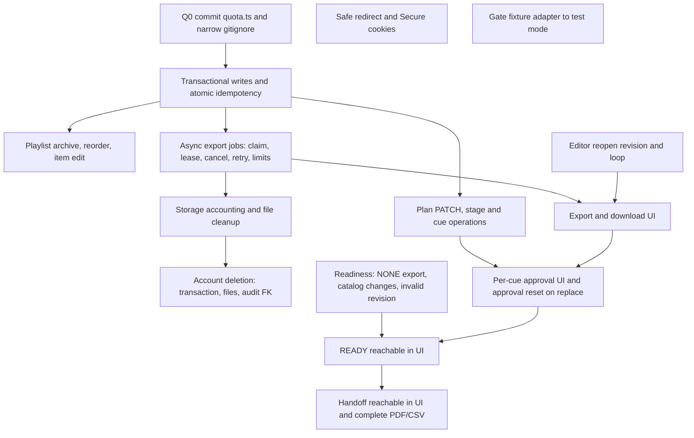

# Functional audit: Wedding Music Planner, WMP-001 to WMP-018

Audit date: 2026-11-20. Scope: `specs/001-wedding-music-planner` (spec, contracts, data model) compared with the code in this repository. No application code was changed during the audit.

## 1. Method and evidence sources

| Role | Agent | Output |
| --- | --- | --- |
| Expected behavior | planner (read-only) | Maps each feature to its FR ids, acceptance scenario ids, contract endpoints and limits |
| Defect confirmation | code-reviewer (read-only) | Gave a verdict with file:line on 53 candidate defects (50 confirmed, 3 partial, 0 rejected) and added 12 new findings |
| Runtime reproduction | qa-tester | Ran Vitest and `tsc`, made HTTP calls to the dev server on `127.0.0.1:3000`, and drove system Chrome over CDP |
| Reconciliation | main agent | Settled conflicting findings and assigned status and severity |

### Environment

- Branch `master` has no commits; every file is untracked.
- `npx vitest run`: 16 files and 31 tests passed. `npx tsc --noEmit`: passed. `npx next build` was not re-run during the audit, because it would overwrite `.next` while the dev server was running. It last passed on 2026-11-20, before the audit.
- **Playwright E2E: BLOCKED.** `@playwright/test` is not in `package.json`, even though the `test:e2e` script calls `playwright test`. Playwright browsers are not installed, and the profile check reports `BROWSER_CHECK=not-pass` on Ubuntu 20.04. System Chrome was driven over CDP only to read page contents and capture screenshots. That is page evidence, not functional E2E proof.
- **Live Google sign-in: BLOCKED.** `AUTH_GOOGLE_ID` and `AUTH_GOOGLE_SECRET` are empty, so `GET /api/auth/google` redirects to `/dang-nhap?error=chua-cau-hinh`.
- **YouTube media acquisition: BLOCKED.** No permitted acquisition method exists. Every real video id ends `FAILED` / `BLOCKED` / `NO_PERMITTED_ACQUISITION_METHOD` with no asset. Only `fixture:` ids produce audio.
- Test users: `audit-a`, `audit-b` (deleted at the end) and `test-admin` (kept).

### Side effects left by the audit

- The 7 files owned by `audit-a` remain under `storage/` after account deletion. This is evidence for defect S2:
  - `exports/48140044…mp3`
  - `exports/cd38c1b3…mp3`
  - `packages/29487135…zip`
  - `source-audio/142a7069…wav`
  - `source-audio/1ddeac49…wav`
  - `waveforms/1fcc2353…json`
  - `waveforms/21f26030…json`
- The `test-admin` account and the published catalog track "Audit Track" (`216f2260…`, with its source and waveform files) remain. This is now the only catalog entry that can be previewed.

### Status and severity definitions

Status:
- **WORKING_VERIFIED**: correct behavior was observed at runtime.
- **PARTIALLY_WORKING**: some required behavior was observed working, and some is missing or wrong.
- **BROKEN**: a required user journey fails.
- **NOT_IMPLEMENTED**: no code exists.
- **BLOCKED**: an external dependency prevents verification.
- **NOT_TESTED**: no runtime check was possible.

No feature is marked WORKING_VERIFIED from reading the source alone.

Severity:
- **P0**: blocks a core user journey.
- **P1**: a spec defect, data loss, or a security problem.
- **P2**: degraded behavior or a robustness gap.
- **P3**: minor.

## 2. Feature audit table

| ID | Feature | Status | Worst | Summary | Section |
| --- | --- | --- | --- | --- | --- |
| WMP-001 | Google sign-in | BLOCKED | P1 | Live Google is unconfigured. Test sessions, logout and returning-user identity are verified. Open redirect in `next`. Account deletion leaves files and fails for admins. | [3.1](#31-wmp-001-google-sign-in) |
| WMP-002 | Discovery | PARTIALLY_WORKING | P2 | Search, accent folding and draft exclusion are verified through the API. The UI lacks mood, style and language filters, sort and pagination. `page=abc` returns 500. | [3.2](#32-wmp-002-discovery) |
| WMP-003 | Detail and preview | PARTIALLY_WORKING | P1 | The permission gate is verified. No Range support. Catalog audio cannot be edited by users. Browser playback NOT_TESTED. | [3.3](#33-wmp-003-detail-and-preview) |
| WMP-004 | Personal library | PARTIALLY_WORKING | P1 | The list renders. No search, revision history, exports, downloads, delete or usage display in the UI. | [3.4](#34-wmp-004-personal-library) |
| WMP-005 | Upload | PARTIALLY_WORKING | P1 | Valid, corrupt and too-long uploads are verified. Retry does nothing. No progress or cancel UI. The whole file is buffered before the size check. | [3.5](#35-wmp-005-upload) |
| WMP-006 | Waveform editor | PARTIALLY_WORKING | P1 | Real peaks and controls render in Chrome. Cannot reopen a revision. Loop is broken. No zoom, drag or seek. Interaction NOT_TESTED in a browser. | [3.6](#36-wmp-006-waveform-editor) |
| WMP-007 | Immutable revisions | PARTIALLY_WORKING | P1 | Insert-only saves are verified. Revisions cannot be reopened or listed in the UI. | [3.7](#37-wmp-007-immutable-revisions) |
| WMP-008 | MP3 export | BROKEN | P0 | A real MP3 (44.1 kHz, 192 kb/s) is verified through the API. No export or download control exists in the UI. A stuck job blocks the user. Retry is missing. | [3.8](#38-wmp-008-mp3-export) |
| WMP-009 | Playlists | PARTIALLY_WORKING | P1 | Version 409 and duplicate items are verified. Rename clears the archive flag. Reorder accepts duplicate ids. Most UI actions are missing. | [3.9](#39-wmp-009-playlists) |
| WMP-010 | Wedding plans | PARTIALLY_WORKING | P1 | Create, suggested template and stale 409 are verified. A partial PATCH wipes date, location and notes. No plan edit UI. | [3.10](#310-wmp-010-wedding-plans) |
| WMP-011 | Stages and cues | PARTIALLY_WORKING | P1 | Add and snapshot work. Stage and cue reorder and remove are NOT_IMPLEMENTED. Replacing a revision keeps its approval. | [3.11](#311-wmp-011-stages-and-cues) |
| WMP-012 | Readiness | BROKEN | P0 | The API flow is verified. The UI has no per-cue listening approval, so READY cannot be reached from the UI. A missing export passes readiness. | [3.12](#312-wmp-012-readiness) |
| WMP-013 | Handoff | BROKEN | P0 | The API builds a ZIP with a real MP3, PDF and CSV. It cannot be reached from the UI. Documents lack version, date, notes and responsible person. | [3.13](#313-wmp-013-handoff) |
| WMP-014 | Admin catalog | PARTIALLY_WORKING | P1 | Create, media, publish and 403 are verified through the API. No category, artist or tag CRUD. The UI creates drafts only. | [3.14](#314-wmp-014-admin-catalog) |
| WMP-015 | Persistence and concurrency | PARTIALLY_WORKING | P2 | Stale versions get 409 with nothing saved. Race windows remain because writes are not transactional and idempotency is not atomic. | [3.15](#315-wmp-015-persistence-and-concurrency) |
| WMP-016 | Storage and deletion | BROKEN | P1 | Verified at runtime: 7 orphaned files after account deletion, and usage drifts upward (export bytes are never subtracted). `quota.ts` is git-ignored. | [3.16](#316-wmp-016-storage-quota-and-deletion) |
| WMP-017 | UX pages | PARTIALLY_WORKING | P2 | 17 pages render in Vietnamese. No error, loading or not-found screens. No unsaved-changes warning. Playwright BLOCKED. | [3.17](#317-wmp-017-ux-pages) |
| WMP-018 | YouTube import | BLOCKED | P1 | Metadata and the honest blocked state are verified. Acquisition BLOCKED. The `fixture:` path has no production gate. Intermediate job states are unused. | [3.18](#318-wmp-018-youtube-import) |

The plan's preliminary status for WMP-015 was BROKEN. It is now PARTIALLY_WORKING, because the runtime checks showed that every write with a stale version is rejected up front (`assertPlanVersion` at `src/server/plans.ts:196`). What remains is the gap between that check and the later version guard.

## 3. Feature sections

Each section covers expected behavior, the request trace, defects, how to reproduce them, tests, and testability. In the defect tables, "Expected / Actual" describes the observed behavior, and "Root cause" is given only when the evidence supports it. Line numbers refer to the tree as it was on the audit date.

### 3.1 WMP-001 Google sign-in

**Expected** (FR-001 to FR-004, US1-AS1 to AS7):
- Google is the only sign-in method.
- Users are identified by `provider + sub`.
- After sign-in the user returns to the page they asked for, if that page is safe.
- Logout revokes the session.
- An account switch clears private data.
- Account deletion removes all private data.

**Trace**:
1. `/dang-nhap` links to `GET /api/auth/google`, which redirects to Google.
2. Google calls `GET /api/auth/google/callback`.
3. The callback runs `src/server/google-token.ts` (jose: issuer, audience, signature, expiry), then `openSession` in `src/server/auth.ts:22`.
4. `openSession` writes `users`, `auth_identities` and `user_sessions`, and sets the cookie `wmp_session`.
5. Test path: `POST /api/session/test`, allowed only when `AUTH_TEST_MODE=true` and not in production.

**Runtime evidence**:
- `audit-a` signed in and `GET /api/library` returned 200.
- After logout, the old cookie got 401 `UNAUTHENTICATED`.
- A second sign-in returned the same user id `87bfda51…`.
- The Google start route redirects to `/dang-nhap?error=chua-cau-hinh`.

| ID | Sev | Expected / Actual | Root cause and evidence |
| --- | --- | --- | --- |
| A1 | P1 | Expected: only same-origin paths are accepted. Actual: the filter accepts `/\evil.com`, and `new URL('/\\evil.com', origin)` resolves to `http://evil.com/` (node logic test). The runtime route test is BLOCKED because Google is unconfigured. | The check `startsWith('/') && !startsWith('//')` misses backslash and control characters. `src/app/api/auth/google/route.ts:10-11`, `src/app/api/auth/google/callback/route.ts:35,39` |
| A2 | P1 | Expected: deletion removes all files. Actual: all 7 files of `audit-a` remained. | `deleteAccount` runs SQL deletes only and never calls `removeStorage`. `src/server/auth.ts:101-114` |
| A3 | P1 | Expected: deletion is atomic. Actual: 4 separate queries, no transaction. For an admin with audit rows, the user delete fails after cues and playlist items are already gone. | `administrative_audit_logs.actor_user_id` has no `ON DELETE` rule (`db/changelog/changelog.sql:268`). `auth.ts:105-113` |
| A4 | P1 | Expected: a returning user's role follows `ADMIN_GOOGLE_SUBS`. Actual: role, name, email and avatar are written only on first insert, so a removed admin keeps the ADMIN role. | `auth.ts:31,40-52` |
| A6 | P2 | Auth cookies never get `Secure`, even in production. | `src/server/http.ts:30,34`, `api/auth/google/route.ts:20-21` |
| A7 | P2 | The editor redirects to `next=/thu-vien` instead of its own page. The test sign-in form always goes to `/bang-dieu-khien`. | `src/app/bien-tap/[assetId]/page.tsx:10`, `src/components/sign-in-form.tsx:23` |
| A5 | P3 | No nonce, no PKCE, and `email_verified` is not checked. Impact is limited, because this is a confidential-client code flow that uses `state`. | `google-token.ts:6-18` |
| A8 | P3 | The state and return cookies are not cleared after the callback, and the token-exchange failure is not caught. | `callback/route.ts:16-26,36-42` |
| A12 | P3 | `users.version` is never incremented, so the deletion version check does nothing. | `auth.ts:102` |

**Reproduce A1**: `node -e "const n='/\\\\evil.com';console.log(n.startsWith('/')&&!n.startsWith('//'), new URL(n,'http://127.0.0.1:3000').href)"` prints `true http://evil.com/`.

**Reproduce A2**:
1. Sign in as a test subject.
2. Upload, export and build a handoff.
3. Record the storage keys.
4. Call `DELETE /api/account` with `{confirm:true, version}`.
5. Run `ls storage/*`. The files remain.

**Tests**:
- Existing: `tests/unit/auth-identity.test.ts` tests helpers that `openSession` does not use. `tests/integration/persistence.test.ts` checks that the same subject gives the same user, and checks `userFromToken`.
- Missing: callback state mismatch; unsafe `next` values (`/\x`, `/\t/x`, `//x`, absolute URLs); expired and revoked session against the DB; account switch; role refresh; deletion removes files and DB rows; deleting an admin who has audit rows.

**Testability**: API-testable with test sessions. Live Google is BLOCKED until credentials are set. The redirect UX needs a browser, and Playwright is BLOCKED.

### 3.2 WMP-002 Discovery

**Expected** (FR-005 to FR-007, US2-AS1 to AS5):
- Published entries only.
- Accent-insensitive search.
- Filters for stage, mood, style, language and vocal type.
- Sort and pagination.
- Clear filters.
- Empty and loading states.

**Trace**: `src/app/kham-pha/page.tsx` (server component) calls `searchCatalog` in `src/server/catalog.ts:39-70`. The search uses SQL `vi_fold`, published-only rows, and `EXISTS` filters.

**Runtime evidence**:
- `q=mau` returns "Mẫu khúc đón khách".
- The draft entry is hidden.
- `stage=don-khach&vocalType=INSTRUMENTAL` returns 1 result.
- `page=abc` returns 500.

| ID | Sev | Expected / Actual | Evidence |
| --- | --- | --- | --- |
| C1a | P2 | The UI has no mood, style or language filters (the API supports them). | `kham-pha/page.tsx:22-42` |
| C1b | P2 | No sort control and no pagination. `page` is never passed, so only the first 20 results can be reached. | `kham-pha/page.tsx:6-15` |
| C2 | P2 | `page=abc` gives `Math.max(1, NaN)`, which is NaN in LIMIT/OFFSET, so the request returns 500 instead of 422. | `catalog.ts:40-41`, `api/catalog/tracks/route.ts:15-16` |
| C3 | P2 | No `loading.tsx`, so there is no loading state. | `src/app` has no `loading.tsx` |
| C4 | P3 | Sorting has no tiebreaker, so paging can be unstable. | `catalog.ts:42-43` |

**Tests**:
- Existing: `catalog-search.test.ts` tests JavaScript `foldVi` and `publicCatalogFilter`, which production does not use.
- Missing: an integration test of SQL search and filters against Postgres, paging and sort, bad paging input returning 422.

**Testability**: the API is fully testable. The UI states need a browser (BLOCKED).

### 3.3 WMP-003 Detail and preview

**Expected** (FR-008 to FR-010, US3-AS1 to AS6):
- Full metadata on the detail page.
- Play, pause and seek.
- Only one active preview.
- No autoplay.
- Listening volume is separate from the saved gain.
- A metadata-only entry cannot be edited.

**Trace**:
- Detail: `src/app/bai-hat/[trackId]/page.tsx` calls `getPublishedTrack`.
- Preview: `GET /api/catalog/tracks/{id}/preview` calls `previewAssetForTrack`, then `readStorage`.
- Player: `src/components/audio-player.tsx`. A module-level `active` element ensures one preview at a time; the element uses `preload="none"`.

**Runtime evidence**:
- The metadata-only track returns 403 `PREVIEW_FORBIDDEN`.
- Before the admin step, the SQL count of previewable published tracks was 0.
- After `test-admin` published "Audit Track", it became previewable.
- `Range: bytes=0-99` returns 200 with no `Accept-Ranges`.

| ID | Sev | Expected / Actual | Evidence |
| --- | --- | --- | --- |
| C5 | P1 | Users cannot edit catalog audio or add it to a playlist (violates FR-012). Catalog assets have `owner_user_id` NULL, and `saveRevision` requires ownership through `getOwnedAsset`. `presentTrack` still reports `editable`. | `src/server/media/assets.ts:182,230,502`, `catalog.ts:88` |
| C6 | P1 | Seeking likely fails: the preview and audio routes ignore Range requests and buffer the whole file. | `api/catalog/tracks/[trackId]/preview/route.ts:9-12`, `api/assets/[assetId]/audio/route.ts:11-14` |
| C7 | P2 | The detail page has no artwork, duration, style or mood. | `catalog.ts:30-37` |
| C8 | P2 | The seed contains no previewable track. The admin UI hard-codes `METADATA_ONLY`. | `changelog.sql:316-345`, `src/app/quan-tri/danh-muc/page.tsx:17` |

**Tests**:
- Existing: `preview-permission.test.ts` (helper only).
- Missing: preview 403/404 against the DB; Range 206; a catalog revision path.

**Testability**: the permission gate is testable through the API. The player behavior (AS1 to AS5) needs a browser (BLOCKED).

### 3.4 WMP-004 Personal library

**Expected** (FR-011, FR-012):
- Browse, search and filter.
- Source and status shown.
- Revision history.
- Export downloads.
- Storage usage.
- Safe delete.

**Trace**: `src/app/thu-vien/page.tsx` (client) calls `GET /api/library`, which calls `listLibrary` in `assets.ts:186-198`.

**Runtime evidence**:
- After the label fix, Chrome showed `tone.wav · Tải lên · Sẵn sàng · WAV` and one link, "Sửa".
- There are no buttons.

| ID | Sev | Expected / Actual | Evidence |
| --- | --- | --- | --- |
| L1 | P1 | No search or filter controls, no revision history, no export or download links, no delete, no usage display. | `thu-vien/page.tsx:14-42` |
| L2 | P1 | The API returns assets only. The contract says assets, revisions and exports. | `assets.ts:186-198`, `contracts/http-api.md:56` |
| L3 | P3 | `getOwnedAsset`, `getRevision` and `getExport` expose internal `storageKey` values. | `assets.ts:176,287,397-399` |

**Tests**: missing for library filters, usage, delete blocked vs allowed, and file and usage cleanup.

**Testability**: API-testable. The page needs a browser.

### 3.5 WMP-005 Upload

**Expected** (FR-013, FR-014, US4-AS1 to AS6):
- MP3 and WAV PCM accepted, validated by probing the codec.
- Limits: 100 MiB and 10 minutes.
- Progress, cancel and retry.
- No uncontrolled duplicates.
- Cleanup after failure.
- Quota enforced.

**Trace**:
1. `src/app/tai-len/page.tsx` sends `POST /api/uploads`.
2. The route reads `request.formData()` and `arrayBuffer()`.
3. `createUpload` (`assets.ts:16-43`) writes a temp file and then calls `processUploadJob` inline.
4. `processUploadJob` probes, copies to `source-audio/`, builds the waveform, and writes the rows.

**Runtime evidence**:
- 2 s WAV: READY in 0.39 s, processed inline.
- Corrupt `.mp3`: `FAILED/INVALID_AUDIO`.
- 11-minute WAV: `FAILED/DURATION_EXCEEDED`, temp file removed.
- Same key with a different file: 409 `IDEMPOTENCY_KEY_REUSED`.
- Same file with a new key: a second asset, and usage doubled.
- Retry on the failed job: unchanged.
- Cancel on a READY job: 409 `ALREADY_READY`.

| ID | Sev | Expected / Actual | Root cause and evidence |
| --- | --- | --- | --- |
| U1 | P1 | Expected: retry reprocesses. Actual: the job is returned unchanged. | `retryUpload` only returns the job, and the temp file was already deleted on probe failure. `assets.ts:67,149-153` |
| U3 | P1 | Expected: oversized files are rejected early. Actual: the whole multipart body, plus a hash copy, sits in memory before the 100 MiB check. | No Content-Length precheck. `api/uploads/route.ts:12-15`, `assets.ts:22,30` |
| U7 | P1 | Expected: concurrent requests with the same key replay safely. Actual: the idempotency check is SELECT, then work, then INSERT, so the second request hits the unique constraint and gets a 500. If processing throws, the key is stuck: every later retry gets a 500 and the copied files are left behind. | `assets.ts:35-41,114-117,454-474`, `changelog.sql:153` |
| U8 | P1 | The worker selects PENDING uploads with no claim, while `createUpload` processes the same job inline. Double processing is possible whenever `npm run worker` is running. Not reproduced: no worker process was running during the audit. | `src/worker/index.ts:8-11`, `assets.ts:35-40,59` |
| U2 | P2 | Cancel cannot interrupt processing, because it happens inside the POST. The READY update has no state guard. | `assets.ts:35-40,109-111,142-147` |
| U4 | P2 | No progress bar, cancel button or retry button. | `tai-len/page.tsx:10-25` |
| U5 | P2 | Route shape is `POST /api/uploads/{id}?action=retry`, and any other action is treated as cancel. The contract has `/cancel` and `/retry`. | `api/uploads/[jobId]/route.ts:21-22` |
| U6 | P3 | `content_hash` is stored but never read, so there is no duplicate detection. | `assets.ts:83,95` |
| U10 | P2 | Quota is checked and later incremented outside one transaction. Imports skip the quota. | `assets.ts:25-31,105-108,476-530` |
| U11 | P2 | WAV is accepted only as `pcm_s16le`, so 24-bit and float PCM are rejected. | `src/server/media/probe.ts:57` |
| U13 | P2 | ffprobe and ffmpeg calls have no timeout. | `probe.ts:40`, `waveform.ts:8`, `export-mp3.ts:28-56` |

**Reproduce U1**:
1. `POST /api/uploads` with random bytes named `bad.mp3`. The job is `FAILED/INVALID_AUDIO`.
2. `POST /api/uploads/{jobId}?action=retry` returns the same FAILED job.

**Tests**:
- Existing: `media-probe.test.ts`; the integration test checks that an upload becomes READY and that another user gets 404.
- Missing: oversized file rejected before buffering; retry reprocesses; concurrent same-key requests; key not stuck after a failure; worker claim excludes inline jobs; quota race; guest 401 with nothing stored; 24-bit WAV.

**Testability**: the API and integration paths are testable. Progress and drag-and-drop need a browser (BLOCKED).

### 3.6 WMP-006 Waveform editor

**Expected** (FR-015 to FR-017, US5-AS1, AS2, AS4 to AS6):
- A waveform drawn from real audio.
- Zoom and draggable trim handles.
- Timestamp entry with 10 ms precision.
- Seek and loop inside the selection.
- Fade and gain preview.
- Clipping warning.
- Reset, undo and redo.
- Reopening a revision restores its exact values.
- Warning on unsaved changes.
- Usable on mobile.

**Trace**: `src/app/bien-tap/[assetId]/page.tsx` loads `src/components/waveform-editor.tsx`. The editor fetches `/api/assets/{id}/waveform` and `/audio`, plays through Web Audio, and saves with `POST /api/assets/{id}/revisions`.

**Runtime evidence**: Chrome rendered a peak strip for `tone.wav`, the inputs (start, end, fade in, fade out, gain) and the buttons Nghe đoạn, Dừng, Lặp đoạn, Hoàn tác, Làm lại, Lưu bản mới. No interaction was exercised in the browser.

| ID | Sev | Expected / Actual | Root cause and evidence |
| --- | --- | --- | --- |
| E1 | P1 | An existing revision cannot be reopened. The editor always starts from defaults. | No `revisionId` input, and no fetch of `/api/revisions/{id}`. `waveform-editor.tsx:13-21`, `bien-tap/[assetId]/page.tsx:7-18` |
| E2 | P1 | Loop plays the whole buffer, and every pass after the first is silent. | `source.loop` is set without `loopStart`/`loopEnd`, and the gain envelope is scheduled only once. `waveform-editor.tsx:67-75` |
| E3 | P2 | No zoom, drag handles, playhead, seek inside the selection, or reset. | `waveform-editor.tsx:80-100` |
| E4 | P2 | No unsaved-changes warning. | No `beforeunload` anywhere in `src` |
| E5 | P3 | The clipping warning is `gainDb > 0` and ignores the actual peaks. | `waveform-editor.tsx:44`, `revision-rules.ts:30-32` |
| E6 | P2 | A new `AudioContext` is created on every play and never closed. The full audio is re-downloaded on every play. Playback is not stopped on unmount. | `waveform-editor.tsx:37,55-56` |
| E7 | P2 | Another user's asset or an unknown asset renders a 500 page instead of a 404. A non-READY asset opens with a fake duration. | No `notFound()` mapping. `bien-tap/[assetId]/page.tsx:12,18` |
| E8 | P3 | Times are entered as raw milliseconds. Every keystroke pushes an undo entry. A double-click on save creates two revisions (a random key per click). | `waveform-editor.tsx:46-50,127` |

**Tests**:
- Existing: `waveform.test.ts` (real peaks), `revision-rules.test.ts`.
- Missing: any component or E2E test. Reopening a revision restores its values; loop playback; undo and redo; unsaved warning; mobile entry.

**Testability**: the rules are API-testable. Everything else needs a browser (BLOCKED).

### 3.7 WMP-007 Immutable revisions

**Expected** (FR-018, FR-019, US5-AS3):
- Each save creates a new row.
- Earlier rows never change.
- Playlist items and cues keep their revision until the user explicitly replaces it.

**Runtime evidence**: two saves produced two distinct ids (`b2a6b56c`, `e27f3a05`). In the integration test, the playlist reference stayed on the original revision.

| ID | Sev | Expected / Actual | Evidence |
| --- | --- | --- | --- |
| V1 | P1 | No UI lists a revision history or reopens a revision (see E1). | `thu-vien/page.tsx`, `waveform-editor.tsx` |
| V2 | P3 | `gainDb` comes back as a string (`"-3.00"`) because the column is `numeric`. | `assets.ts:244,266` |

**Missing tests**: the earlier revision row is byte-identical after a later save; the source hash is unchanged; a playlist item still references revision A after revision B is saved, checked through HTTP.

### 3.8 WMP-008 MP3 export

**Expected** (FR-020, FR-021, US6-AS1 to AS5):
- States QUEUED, PROCESSING, VERIFYING, COMPLETED, FAILED, CANCELLED.
- At most 1 active and 5 queued exports per user.
- Retry and cancel work.
- The job survives a closed page.
- The file is private.
- A UI exists to export and download.

**Trace**: `POST /api/revisions/{id}/exports` calls `queueExport` (`assets.ts:295-323`). It inserts QUEUED and then calls `processExport` inline (`:319`), which renders with ffmpeg (`export-mp3.ts`), verifies with ffprobe, and sets COMPLETED. The worker claim (`src/worker/claim.ts`) only selects QUEUED.

**Runtime evidence**:
- Export `3370cb43` returned 201 COMPLETED in 0.63 s.
- ffprobe on the download: mp3, 44,100 Hz, stereo, 192 kb/s, 1.6457 s for a 1.600 s clip.
- After forcing that job to PROCESSING, the next two export requests (10 s apart) both returned 409 `EXPORT_BUSY`.
- Cancel set CANCELLED, but the file and its 40,168 bytes stayed counted.
- Another user got 404 on the file.

| ID | Sev | Expected / Actual | Root cause and evidence |
| --- | --- | --- | --- |
| X1 | P0 | No page or component calls `/revisions/{id}/exports` or `/api/exports/*`, so users cannot export or download. | `waveform-editor.tsx`, `thu-vien/page.tsx` (CDP button lists confirm this) |
| X3 | P1 | A job stuck in PROCESSING or VERIFYING is never recovered and blocks every new export with `EXPORT_BUSY`. | `claim.ts:6-7` claims only QUEUED; there is no lease or timeout; ffmpeg has no timeout. `assets.ts:300-309` |
| X2 | P1 | Cancel does not stop ffmpeg. A cancelled job can be overwritten to COMPLETED. Cancel is allowed on terminal states. | No `AbortSignal` or kill; no `AND state` guard. `assets.ts:375-380,407-412` |
| X6 | P1 | The inline path and the worker can process the same QUEUED row: two renders, quota charged twice. Not reproduced; no worker process was running. | `assets.ts:314-319,347`, `claim.ts:3-17` |
| X4 | P2 | A second export is rejected instead of queued, so the 5-queued limit can never be reached. | `assets.ts:307-312,319` |
| X5 | P2 | There is no retry endpoint. POST `/api/exports/{id}` means cancel. | `api/exports/[exportId]/route.ts:15-23` |
| X9 | P2 | A failed render leaves its partial output file. | `assets.ts:386-391` |
| X11 | P3 | Progress values are hard-coded. | `assets.ts:348,363` |

**Reproduce X3**:
1. Export once.
2. `docker exec planner-wedding-music-db-1 psql -U wedding -d wedding_music -c "UPDATE export_artifacts SET state='PROCESSING' WHERE id='<id>'"`
3. Save a new revision and POST an export. It returns 409 `EXPORT_BUSY` indefinitely.

**Tests**:
- Existing: `mp3-export.test.ts` (real MP3 with the trimmed duration); integration export to COMPLETED.
- Missing: the state sequence including VERIFYING; cancel during processing; retry of a FAILED job; the 1-active and 5-queued limits; concurrent duplicate requests; recovery of a stale PROCESSING job; worker claim versus the request; export survives a closed request (process restart).

**Testability**: API-testable. The UI flow is not implemented, so no browser test is possible yet.

### 3.9 WMP-009 Playlists

**Expected** (FR-022, FR-023, US7-AS1 to AS5):
- Create, rename, description, duplicate, archive, delete.
- Add, remove and reorder items.
- Select a revision per item, notes per item.
- Total duration and preview.
- Version conflicts are detected.

**Trace**: `src/app/danh-sach-phat/**` calls `/api/playlists/**`, which calls `src/server/playlists.ts`.

**Runtime evidence**:
- PATCH `archived:true` set `archived_at`. A following PATCH with only a name set it back to NULL.
- The same revision added twice gave two item ids.
- Reorder with `[I1, I1]` returned 200, and positions became I1=1, I2=100001.
- A stale PATCH returned 409.
- A stale add-item returned 409 with nothing saved.

| ID | Sev | Expected / Actual | Root cause and evidence |
| --- | --- | --- | --- |
| P-ARCH | P1 | Renaming a playlist un-archives it. | `archived_at = CASE WHEN $5 THEN now() ELSE NULL END` with `$5 = input.archived === true`. `playlists.ts:54,59` |
| P-REORDER | P2 | Duplicate ids are accepted, which corrupts positions. The result of the version-bump UPDATE is ignored. | Only the array length is checked. `playlists.ts:126,131-141` |
| P-ADD | P2 | Concurrent adds collide on `UNIQUE(playlist_id, position)` and return 500. The insert is committed before the version guard runs. | Position is computed before the insert, with no transaction. `playlists.ts:105-110,117-119` |
| P-UI | P1 | No UI for rename, description, duplicate, archive or delete. The revision is entered as a raw UUID. No note, preview or "move down". Total duration is shown in raw milliseconds. | `danh-sach-phat/[playlistId]/page.tsx:37-69` |
| P-ITEM | P1 | There is no API to change an item's note or revision (contract `PATCH items/{itemId}`). | `api/playlists/[playlistId]/route.ts:54-79` |
| P-DESC | P3 | A description cannot be cleared to null. | `playlists.ts:59` |
| P-409UI | P2 | The UI never reloads the version after a 409. | `danh-sach-phat/[playlistId]/page.tsx:48-56` |

**Tests**:
- Existing: the unused `playlist-version` helper; one stale `updatePlaylist` call in the integration test.
- Missing: rename keeps the archive flag; reorder rejects duplicates and persists the order; concurrent adds; remove and compaction; duplicate playlist independence through HTTP.

### 3.10 WMP-010 Wedding plans

**Expected** (FR-024, FR-025, US8-AS1, AS5, AS6):
- Create an empty or suggested plan.
- Edit, duplicate, archive, reopen.
- Delete with confirmation.
- No shared state between a plan and its copy.

**Runtime evidence**:
- Creating a suggested plan gave 11 stages.
- A PATCH with date, location and notes saved them. A following PATCH with only a name set all three to NULL.
- `weddingDate` is serialized as `2027-05-01T07:00:00.000Z` (server time zone).
- A stale add-stage returned 409 with nothing saved.

| ID | Sev | Expected / Actual | Root cause and evidence |
| --- | --- | --- | --- |
| PL-PATCH | P1 | Fields left out of a PATCH are wiped. READY is not invalidated. | `$n ?? null` for each field; the update result is not checked; `touchPlan` is not called. `plans.ts:130-135` |
| PL-DATE | P2 | The DATE column is returned as a timestamp shifted by the server time zone. | node-pg default parsing of DATE. `plans.ts:70` |
| PL-UI | P1 | The plan page has no edit, duplicate, archive or delete controls. | `ke-hoach/[planId]/page.tsx` |
| PL-VAL | P2 | The action POST is validated with `z.record(z.unknown())`. Bad input reaches Postgres and returns 500. | `api/plans/[planId]/route.ts:64-75` |
| PL-ARCH | P3 | Reopen always sets DRAFT and does not check the update result. | `plans.ts:175-183` |

**Tests**: missing for a partial PATCH keeping fields; duplicate deep copy against the DB; archive and reopen; delete confirmation.

### 3.11 WMP-011 Stages and cues

**Expected** (FR-026 to FR-028, US8-AS2 to AS4):
- Stages: add, rename, reorder, duplicate, remove, set time, duration and status.
- Cues: add, reorder, replace, remove, set instruction and responsible person.
- Playlist snapshot with an explicit refresh.
- Cues are kept when a stage's status changes.

**Runtime evidence**: the actions `reorder-stages`, `remove-stage`, `delete-stage`, `reorder-cues`, `remove-cue` and `delete-cue` all returned 422 "Thao tác kế hoạch không hợp lệ". Snapshot isolation passes in the integration test.

| ID | Sev | Expected / Actual | Root cause and evidence |
| --- | --- | --- | --- |
| PL-MISSING | P1 | NOT_IMPLEMENTED: stage reorder, duplicate and remove; cue reorder and remove. | No functions in `plans.ts`; the route only dispatches existing actions. `api/plans/[planId]/route.ts:67-99` |
| PL-REPLACE | P1 | Replacing a cue's revision keeps `listening_approved_at`, so audio nobody has heard stays approved. | `plans.ts:298-300` |
| PL-STAGE | P2 | `approximateTime` and `estimatedDurationMs` are never passed through. A null description becomes the string `"null"`. | `api/plans/[planId]/route.ts:71-76` |
| PL-REFRESH | P2 | Refresh deletes cues from every source playlist, not only the given one. Not transactional. | `plans.ts:263-277` |
| PL-CUE-UI | P1 | The plan UI only offers "Thêm điểm nhạc", with a raw UUID input shared across all stages and a hard-coded instruction. No snapshot, cue edit or stage edit. | `ke-hoach/[planId]/page.tsx:12,37-59` |

**Tests**: missing for every stage and cue operation; refresh scope; replacing a revision clears approval; status change keeps cues (HTTP).

### 3.12 WMP-012 Readiness

**Expected** (FR-029, FR-030, US9-AS1 to AS4):
- Named checks for missing cues, missing source, invalid revision, unavailable media, failed or unfinished export, unreviewed cue, permission, and duration.
- System readiness is separate from listening approval.
- Any change invalidates the approval.

**Runtime evidence**:
1. GET readiness returned `[UNREVIEWED_CUE]`. Confirming at that point returned 422 `NOT_READY`.
2. `update-cue listeningApproved:true` through the API cleared the checks. Confirm returned READY.
3. Editing the instruction moved the plan to NEEDS_REVIEW and marked the package outdated. The cue's own approval was kept.
4. Chrome: the plan page shows "· đã nghe" as text only. `/san-sang` has only the plan-level button "Tôi đã nghe và xác nhận".

| ID | Sev | Expected / Actual | Root cause and evidence |
| --- | --- | --- | --- |
| R1 | P0 | READY cannot be reached from the UI, because no per-cue listening-approval control exists. | `ke-hoach/[planId]/page.tsx:44` displays approval only; the API supports it at `route.ts:96` |
| R2 | P1 | A cue with no export (`NONE`) passes readiness, and handoff later fails with `INCOMPLETE_PACKAGE`. There is no invalid-revision check. METADATA_ONLY, unpublished or replaced catalog media is not flagged (FR-034). | `readiness.ts:53,61-75`, `plans.ts:350-371`, `handoff.ts:30` |
| R3 | P2 | The confirm update's row count is ignored. The readiness page treats a failed GET as "all checks passed" and sends `version: undefined`. | `plans.ts:329-334`, `san-sang/page.tsx:13-16,22` |
| R4 | P2 | `DURATION_MISMATCH` effectively never fires, because the export step already rejects any difference over 200 ms. | `assets.ts:367`, `readiness.ts:84` |
| R5 | P2 | Changing listening approval or the responsible person does not bump the plan version. | `plans.ts:312-313` |

**Tests**: missing for each check code; `NONE` export blocks readiness; catalog unpublish or replace raises a warning; confirm race; invalidation through the real `touchPlan` over HTTP.

**Testability**: API verified. The UI flow is not implemented.

### 3.13 WMP-013 Handoff

**Expected** (FR-031, FR-032, US9-AS5 to AS7):
- A ZIP with verified MP3s, PDF and CSV, built from one consistent snapshot.
- Contents: name, version, date, time zone, ordered stages and cues, file names, durations, instructions, notes.
- Skipped stages excluded. Incomplete packages rejected. Outdated packages marked.

**Runtime evidence**:
- Package `05dbe540` was COMPLETED in 0.97 s. It contains `huong-dan.pdf` (9,223 B), `huong-dan.csv` (184 B) and `01-le-ruoc-dau.mp3` (mp3, 44.1 kHz, 1.541 s).
- The documents omit the plan version, date, notes and responsible person ("DJ Nam").
- After an edit, the package was marked `isOutdated:true`.
- In Chrome, `/ban-giao` shows only "Tạo gói ZIP".

| ID | Sev | Expected / Actual | Root cause and evidence |
| --- | --- | --- | --- |
| H0 | P0 | Handoff cannot be reached from the UI. It needs a completed export and an approved cue per stage, and the UI provides neither (X1, R1). | `handoff.ts:16-31` |
| H1 | P1 | The PDF and CSV lack the plan version, date, notes and responsible person (FR-031). | `handoff.ts:69-107` |
| H2 | P2 | No consistent snapshot: the build makes separate reads with no transaction or lock. MP3s are not re-probed during packaging. No `archive.on('error')` handler. | `handoff.ts:16-32,56-66` |
| H3 | P2 | CSV formula injection: a leading `=`, `+`, `-` or `@` in user text is not neutralized. | `handoff.ts:72-75` |
| H4 | P2 | The ZIP is written to disk and then read fully into memory. Packages are never deleted and never counted against the quota. | `handoff.ts:57,123`, `api/plans/[planId]/handoff/route.ts:22` |
| H5 | P2 | The handoff page loses the package id on reload and lists no earlier packages. | `ke-hoach/[planId]/ban-giao/page.tsx` |

**Tests**:
- Existing: `handoff-package.test.ts` (naming, outdated); integration ZIP entry names.
- Missing: PDF and CSV field content; every MP3 decodes and matches its revision duration; incomplete package rejected; concurrent edit during the build; another user downloading gets 404.

### 3.14 WMP-014 Admin catalog

**Expected** (FR-033, FR-034, US10-AS1 to AS5):
- CRUD for categories, artists, tags and recommended stages.
- Media upload and replacement as a new version.
- Publish and unpublish.
- Failures and audit views.
- Readiness warnings when media changes.

**Runtime evidence**:
- `audit-a` got 403 on `/api/admin/failures` and on track create.
- `test-admin` created a track, uploaded media (version 2) and published it (version 3). The track appeared in search as previewable.
- The listing showed `durationMs:null` even though the media duration is known.

| ID | Sev | Expected / Actual | Evidence |
| --- | --- | --- | --- |
| AD1 | P1 | No category, artist, tag or stage CRUD; no track list or edit; no `PATCH /admin/tracks/{id}`. | `src/app/api/admin/` contains only `tracks` and `failures` |
| AD2 | P1 | The admin UI only creates a hard-coded INSTRUMENTAL / METADATA_ONLY draft. No publish, media or audit UI. | `quan-tri/danh-muc/page.tsx`, `quan-tri/page.tsx` |
| AD3 | P2 | Create and replace are not transactional. `replaceCatalogMedia` has no version check. `setPublishState` ignores the update's row count. | `admin-catalog.ts:13-67` |
| AD4 | P2 | Catalog media skips the size and quota checks; an oversized file fails a DB check with a 500. | `assets.ts:476-530` |
| AD5 | P3 | The track `duration_ms` is not updated from the media. The failures view omits export and catalog failures. | `admin-catalog.ts:69-77` |

**Tests**: missing for route-level 401 and 403, audit rows written, unpublish hides the track and raises a readiness warning, replace keeps the old asset. The existing `admin-auth.test.ts` tests an unused helper.

### 3.15 WMP-015 Persistence and concurrency

**Expected** (FR-035):
- Version-based conflict detection.
- Idempotent important operations.
- No silent overwrite.
- Data survives refresh and is visible from another device.

**Runtime evidence**:
- Stale add-item, add-stage and PATCH requests returned 409 with nothing saved.
- Same key with the same payload replayed the original result.
- Same key with a different payload returned 409 for uploads.
- For YouTube imports, the same key with a different URL silently returned the old job.

| ID | Sev | Expected / Actual | Root cause and evidence |
| --- | --- | --- | --- |
| CC1 | P2 | A version check runs first (`assertPlanVersion`), but the child write and the version guard in `touchPlan` / `bumpPlaylist` are separate statements with no transaction. A write that lands between them is committed and still returns 409. The window is narrow; this is a race, not a deterministic failure. | `plans.ts:196-201,217-223,240-245,263-277,297-313,386-391`, `playlists.ts:105-119` |
| U7 | P1 | Idempotency is not atomic (see section 3.5). | `assets.ts:454-474` |
| CC2 | P2 | YouTube imports bypass `idempotency_records`, so a reused key with a different URL silently returns the old job. | `youtube/imports.ts:16-23` |
| CC3 | P2 | Postgres errors 23505, 22P02 and 22007 are not mapped and return 500. | `http.ts:11-20` |
| CC4 | P3 | The `version` columns on stages and cues are never checked. An over-long idempotency key (more than 200 characters) returns 500. | `changelog.sql:150,237,252` |
| CC5 | P2 | No page reloads after a 409, and there is no conflict message. | playlist and plan pages |

**Tests**: missing for concurrent same-key requests; an interleaved write between the check and the guard (inject a delay); YouTube key reuse returns 409; a two-tab conflict message (browser, BLOCKED).

### 3.16 WMP-016 Storage, quota and deletion

**Expected** (FR-036, FR-004, FR-014, US12-AS1 to AS5):
- Accurate usage and an enforced quota.
- Temporary files cleaned up.
- An asset in use cannot be deleted.
- Deletion removes the asset's files.
- Account deletion removes all of the user's files.

**Runtime evidence** (`storageUsedBytes` over time):

| Step | Value |
| --- | --- |
| Start | 0 |
| After 2 uploads | 352,956 |
| After 3 exports | 470,952 |
| After deleting an asset that had an export | 294,474 (only the source was subtracted; 40,168 export bytes stayed counted) |

Account deletion left all 7 files on disk.

| ID | Sev | Expected / Actual | Root cause and evidence |
| --- | --- | --- | --- |
| Q0 | P1 | `src/server/storage/quota.ts` is excluded by `.gitignore:20` (`storage/`), confirmed with `git check-ignore -v`. A fresh clone cannot resolve the imports in `assets.ts:11` and `tests/unit/storage-quota.test.ts:2`. | `.gitignore:20` |
| S2 | P1 | Account deletion orphans every private file and handoff ZIP (see A2). | `auth.ts:101-114` |
| S1 | P1 | Usage only grows: export bytes are added but never subtracted on asset delete or cancel. Usage can block uploads with `QUOTA_EXCEEDED` even when little data is stored. | `assets.ts:381-384` vs `446-450` |
| S3 | P2 | `deleteAsset` is not transactional: the dependency check and the delete can race, and a file-removal failure returns 500 after the commit. | `assets.ts:431-452` |
| S4 | P2 | No sweeper for temp files or orphans. Error paths (U7, X9) leave files. | none |
| S5 | P2 | No UI for deletion, dependency display or a usage breakdown. | `thu-vien/page.tsx`, `tai-khoan/page.tsx` |
| S6 | P2 | Handoff packages are never deleted, including by `deletePlan`. | `plans.ts:191`, `handoff.ts` |
| S7 | P3 | A playlist reference also blocks deletion (the schema requires this), but the error lists playlist names under `plans`. | `assets.ts:414-429` |

**Tests**: missing for asset delete returning usage to the baseline (export bytes included) and removing files; account delete removing every file for that user and none for other users; a 409 `ASSET_IN_USE` listing plan names; no temp files after failed uploads or exports; a fresh clone building (CI).

### 3.17 WMP-017 UX pages

**Expected** (FR-037, FR-038):
- About 19 page types in Vietnamese, responsive.
- Accessible with the keyboard and a visible focus.
- Empty, loading and error states.
- Confirmation before destructive actions.
- Unsaved-changes warnings.
- A non-drag alternative for every drag task.

**Runtime evidence**:
- Chrome rendered, on desktop: landing, discovery, track detail, sign-in, dashboard, library, editor, plan list, plan detail, readiness, handoff.
- Landing and discovery were also captured at mobile width (390 px).
- Copy is Vietnamese.

| ID | Sev | Expected / Actual | Evidence |
| --- | --- | --- | --- |
| UX1 | P2 | No `error.tsx`, `loading.tsx`, `not-found.tsx` or `global-error.tsx`. | `src/app` |
| UX2 | P2 | No unsaved-changes warnings. Only account deletion asks for confirmation. | E4; `tai-khoan/page.tsx:25` |
| UX3 | P2 | There is no dedicated exports page. The timeline and cue editor is not functional. | page inventory |
| UX4 | P2 | Several pages show raw enum values or UUIDs (plan detail, playlist detail). | `ke-hoach/[planId]/page.tsx`, `danh-sach-phat/[playlistId]/page.tsx` |
| UX5 | P3 | The Taste skill finish gate has not been run. Accessibility (keyboard, focus, WCAG 2.2 AA) was not measured. | NOT_TESTED |

**Testability**: almost all of this needs a browser. Playwright is BLOCKED.

### 3.18 WMP-018 YouTube import

**Expected** (FR-039 to FR-043, US11-AS1 to AS8):
- Parse watch, youtu.be and Shorts URLs.
- Show real metadata.
- When no permitted method exists, end BLOCKED with no asset and no fake waveform.
- A permitted test source becomes playable, editable and exportable.
- Job states, retry, cancel and duplicate prevention.

**Trace**:
1. `tai-len/page.tsx` calls `POST /api/youtube/metadata` (oEmbed), then `POST /api/youtube/imports`.
2. `createImport` (`src/server/youtube/imports.ts`) runs `inspectAcquisition`.
3. A `fixture:` id goes through `registerReadyAsset`. Anything else ends `FAILED/BLOCKED`.

**Runtime evidence**:
- `jNQXAC9IVRw` returned "Me at the zoo" / "jawed" and `BLOCKED`. The import ended `FAILED/BLOCKED/NO_PERMITTED_ACQUISITION_METHOD` with `assetId:null`.
- `example.com` returned 422 `MALFORMED_URL`.
- `fixture:tone` became READY_FOR_EDITING with an asset.
- `youtu.be/jNQXAC9IVRwEXTRA` was accepted.
- A reused key with a different URL returned the old job.

| ID | Sev | Expected / Actual | Root cause and evidence |
| --- | --- | --- | --- |
| Y0 | BLOCKED | Permitted media acquisition does not exist; this is a release dependency. | `contracts/media-acquisition.md`, `src/server/youtube/acquisition.ts` |
| Y1 | P1 | The `fixture:` path is enabled in production (no `AUTH_TEST_MODE` or production check). For a missing fixture it writes files into `tests/fixtures/media` with ffmpeg, which breaks the read-only fixture contract. It skips the quota. | `imports.ts:24-44,80-103` |
| Y2 | P2 | Only READY_FOR_EDITING and FAILED are ever written; the other states are unused. Cancel always returns 409. No retry endpoint. | `imports.ts:37-41,54-70` |
| Y3 | P2 | A reused idempotency key with a different URL returns the old job instead of 409 (CC2). | `imports.ts:16-23` |
| Y4 | P3 | `slice(0, 11)` accepts over-long ids. `/embed/` and `/live/` URLs are rejected. | `src/server/youtube/url.ts:21` |
| Y5 | P3 | `fetch` has no timeout. oEmbed is called twice per UI submit. | `metadata.ts:24`, `tai-len/page.tsx:51-65` |

SSRF: no issue found. Outbound URLs are rebuilt from a validated 11-character id against fixed hosts (`metadata.ts:19,24,38`).

**Tests**:
- Existing: `youtube-import.test.ts` (parsing, inspect); integration test for the fixture import and a malformed host.
- Missing: blocked job persisted with no asset (DB); oEmbed 401, 403, 404 and 5xx; key reuse returns 409; fixture refused when not in test mode; over-long id rejected; editing and exporting imported audio over HTTP.

## 4. Cross-cutting findings

1. **Mutations are not transactional.** Playlist, plan, admin and asset deletion write in several statements (CC1, S3, AD3, A3).
2. **Idempotency is not atomic.** A failed request leaves the key unusable (U7, CC2).
3. **Contract drift.** Many routes listed in `contracts/http-api.md` are folded into action POSTs or missing: stage and cue routes, `/cancel` and `/retry` for uploads, exports and imports, `/readiness/confirm`, `/handoff/{id}/file`, and the admin category, artist and tag routes.
4. **Tests cover code production does not call.** `publicCatalogFilter`, `duplicatePlan`, `requiredPackageEntries`, `playlists/items.removePlaylistItem`, `admin/authz.requireAdmin` and `listeningVolumeChangesGain` are only used by tests. Only one integration test exercises the real SQL.
5. **Postgres errors are not mapped** to 409 or 422 (CC3).
6. **Tooling gaps.** `db:seed` points to the missing `scripts/seed.mjs`. `@playwright/test` is not a dependency. The rate limiter is in-memory and grows without bound (`http.ts:5,45-53`).
7. **No timeouts** on ffmpeg, ffprobe or outbound fetch (U13, Y5).

## 5. Fix dependencies

`redirectFix` and `fixtureGate` have no dependencies and can be done at any time.

## 6. Recommended repair order and proof tests

| Step | Repair | Defects | Test that proves it |
| --- | --- | --- | --- |
| 1 | Narrow `.gitignore` to `/storage/` and track `src/server/storage/quota.ts` | Q0 | `git check-ignore src/server/storage/quota.ts` exits 1; a clean clone passes `npm ci && npx tsc --noEmit && npx vitest run` |
| 2 | Safe redirect helper, `Secure` cookies in production, clear OAuth cookies | A1, A6, A8 | Unit table test: `/\evil.com`, `/\t/x`, `//x`, `https://x` all fall back to `/bang-dieu-khien`; a valid `/ke-hoach/1` is kept |
| 3 | Gate the fixture adapter behind `AUTH_TEST_MODE` and non-production; make it read-only; strict id length | Y1, Y4 | Integration: `fixture:tone` returns 422 when test mode is off; a missing fixture creates no file; `youtu.be/<12 chars>` returns 422 |
| 4 | Wrap mutations in transactions with a guarded `UPDATE … WHERE version=$n` first; make idempotency atomic (reserve the key in the same transaction); map 23505/22P02 | CC1, U7, CC2, CC3, P-ADD, PL-ARCH, AD3 | Integration: two concurrent same-key requests give one job and one replay; an injected interleaving leaves no child row after a 409; YouTube key reuse returns 409 |
| 5 | Fix the data-loss bugs: playlist archive flag, plan partial PATCH (+ `touchPlan`), description null, reorder validation | P-ARCH, PL-PATCH, P-DESC, P-REORDER | Integration: rename keeps `archivedAt`; name-only PATCH keeps date, location and notes and moves READY to NEEDS_REVIEW; reorder `[a,a]` returns 422 |
| 6 | Async export pipeline: no inline processing, `FOR UPDATE SKIP LOCKED` claim with a lease, stale-job recovery, ffmpeg timeout and kill on cancel, state guards, retry endpoint, 1-active/5-queued, partial file cleanup | X2-X6, X9, U2, U8, U13 | Integration: forced-stale PROCESSING is recovered within the lease; cancel during render ends CANCELLED with no file; a seventh request returns 409; FAILED to retry to COMPLETED; double claim gives one render |
| 7 | Storage accounting and cleanup: subtract export and package bytes, delete files transactionally, temp sweeper | S1, S3, S4, S6, X9 | Integration: upload, export, delete returns usage to baseline and leaves no files for that asset |
| 8 | Account deletion in one transaction, file removal for all keys, audit FK set to `ON DELETE SET NULL` (SQL changeset), profile and role refresh | A2, A3, A4, A12 | Integration: deleting an admin with audit rows succeeds; zero files remain for that user; another user's files are unchanged; a removed allowlist subject signs in as USER |
| 9 | Stage and cue operations (reorder, duplicate, remove), time and duration fields, approval reset on revision replace, refresh scoped to the playlist | PL-MISSING, PL-STAGE, PL-REPLACE, PL-REFRESH, R5 | Integration: each operation persists after reload; replacing a revision clears `listeningApprovedAt`; refresh of playlist A keeps cues from playlist B |
| 10 | Readiness rules: `NONE` export check, invalid revision, METADATA_ONLY/unpublished/replaced catalog warnings, confirm row count | R2, R3, R4 | Integration: a cue without export gives `MISSING_EXPORT`; unpublishing the track gives a permission warning; a concurrent edit makes confirm return 409 |
| 11 | Editor: reopen a revision (`?revisionId=`), correct loop with `loopStart`/`loopEnd` and a re-armed envelope, `beforeunload`, single `AudioContext`, 404 mapping | E1, E2, E4, E6, E7, A7 | Component test with a mocked AudioContext; browser test when a runtime exists (BLOCKED today) |
| 12 | Export and download UI (editor and library), revision history in the library, delete with dependency display | X1, V1, L1, L2, S5 | Browser: export from the editor, then download, then ffprobe on the downloaded file. Until Playwright is available, an HTTP test plus a CDP button inventory, reported as BLOCKED for E2E |
| 13 | Per-cue approval UI, stage and cue editing UI, playlist snapshot UI, handoff page with package history | R1, PL-CUE-UI, H5 | E2E scenario 22: build a plan in the UI, approve each cue, confirm, download the ZIP, verify MP3 decode and PDF/CSV content |
| 14 | Handoff completeness: version, date, notes and responsible person in PDF and CSV; snapshot transaction; re-probe MP3s; CSV formula escaping; streaming download | H1-H4, PL-DATE | Integration: parse the CSV and PDF text for every FR-031 field; a cell beginning `=1+1` is escaped; a missing MP3 rejects the package |
| 15 | Catalog and admin: catalog revision path (copy into a user asset or allow catalog ownership), Range support, filter, sort and paging UI, admin CRUD and publish UI | C5, C6, C1, C2, AD1, AD2, AD4 | Integration: a user saves a revision from a published catalog track; `Range` returns 206; `page=abc` returns 422; admin category CRUD with audit rows |
| 16 | UX states: `error.tsx`, `loading.tsx`, `not-found.tsx`, Vietnamese labels instead of raw enums, Taste finish gate, accessibility pass | UX1-UX5 | Browser and axe scan when a runtime exists; until then BLOCKED |

Steps 1 to 3 have no dependencies. Step 4 must come before steps 5, 6 and 9. Step 6 must come before steps 7 and 12. Steps 9, 10 and 12 must all come before step 13.

## 7. Ten highest-impact issues

| Rank | Sev | Issue | Feature | Evidence |
| --- | --- | --- | --- | --- |
| 1 | P0 | No per-cue listening-approval control, so READY and handoff cannot be reached from the UI | WMP-012/013 | CDP button inventory of `/ke-hoach/{id}`; `ke-hoach/[planId]/page.tsx:44` |
| 2 | P0 | No MP3 export or download control anywhere in the UI | WMP-008/004 | CDP inventory of `/bien-tap`, `/thu-vien`; no fetch of `/exports` in `src` |
| 3 | P1 | `src/server/storage/quota.ts` is git-ignored, so a fresh clone or CI build fails | WMP-016 | `git check-ignore -v` → `.gitignore:20` |
| 4 | P1 | Account deletion leaves all files (7 verified), is not atomic, and fails for admins with audit rows | WMP-001/016 | QA check 5; `auth.ts:101-114`; `changelog.sql:268` |
| 5 | P1 | A stuck PROCESSING export blocks the user indefinitely; there is no recovery or timeout; the inline path and the worker can render the same job twice | WMP-008 | QA check 4; `claim.ts:6-7`; `assets.ts:300-319` |
| 6 | P1 | Data loss: a name-only plan PATCH wipes date, location and notes; renaming a playlist un-archives it | WMP-010/009 | QA checks 6 and 7; `plans.ts:130-135`; `playlists.ts:54` |
| 7 | P1 | Open redirect through `next=/\evil.com` in the Google start and callback routes | WMP-001 | node logic test; `api/auth/google/route.ts:11`; `callback/route.ts:35` |
| 8 | P1 | Stage and cue reorder, duplicate and remove are not implemented | WMP-011 | QA check 7 (422 for every action); `api/plans/[planId]/route.ts:67-99` |
| 9 | P1 | The editor cannot reopen a revision, and loop playback is broken | WMP-006/007 | `waveform-editor.tsx:13-21,67-75` |
| 10 | P1 | Storage usage drifts upward (export bytes never subtracted, cancel keeps bytes), which leads to false `QUOTA_EXCEEDED` | WMP-016 | QA check 5 (after asset delete, 294,474 B recorded, which still includes the deleted export's 40,168 B); `assets.ts:381-384,446-450` |

Just below the top ten:
- Upload retry does nothing (U1).
- The fixture path is enabled in production (Y1).
- A missing export passes readiness (R2).
- Handoff documents lack version, date, notes and responsible person (H1).
- Replacing a revision keeps its approval (PL-REPLACE).
- Idempotency is not atomic (U7).

## 8. Actionable repair plan

1. **Make the repository buildable from a clean checkout.** This is step 1. Fix `.gitignore`, add the missing `scripts/seed.mjs` or remove the `db:seed` script, and add `@playwright/test` only once a supported browser runtime exists.
2. **Close the security and gating gaps.** These are steps 2 and 3 and are independent of everything else: safe redirect, `Secure` cookies, fixture adapter gated to test mode.
3. **Establish transactional write and idempotency primitives** (step 4), then fix the data-loss bugs on top of them (step 5). Each fix starts with a failing integration test against Postgres, following the TDD skill.
4. **Rebuild export as a real background job** (step 6). Then fix storage accounting and deletion (steps 7 and 8). Verify with byte-for-byte usage checks and a file inventory after each operation.
5. **Complete the plan model** (steps 9 and 10) so that readiness reflects every FR-029 check.
6. **Wire the UI to the existing APIs** (steps 11 to 13) in this order: editor reopen and loop, export and download, per-cue approval, stage and cue editing, handoff history. Prove the flow with acceptance scenario 22. Report the result as BLOCKED until a browser runtime runs Playwright; CDP page inventories may support the claim but do not replace E2E.
7. **Fill handoff content, catalog and admin, and UX states** (steps 14 to 16).
8. **Re-audit.** Re-run this audit, the full Vitest suite, `tsc` and `next build`. Move a feature to WORKING_VERIFIED only with runtime evidence. WMP-001 stays BLOCKED until Google credentials exist. WMP-018 acquisition stays BLOCKED until a permitted acquisition method is approved and documented.
