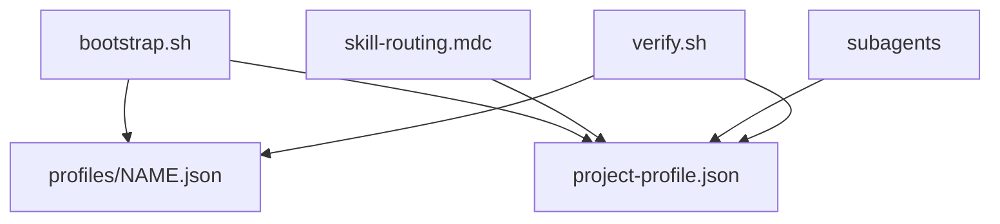

# Quy trình làm việc

Agent chính của Cursor điều phối. Subagent chỉ nhận phần việc đúng profile đang chọn.

## Chọn profile

1. Đọc `profiles/<tên>.json` để thấy agent và skill bắt buộc.
2. Chạy `bash scripts/bootstrap.sh --profile <tên>`.
3. Mở `.cursor/project-profile.json`. File này là cấu hình dự án mà rule và subagent cùng đọc.
4. Chạy lại cùng lệnh là an toàn. Khóa lạ trong file chọn profile được giữ lại.

`--react` chỉ bật hướng dẫn hiệu năng React/Next.js. Profile `backend` không đòi hỏi giao diện web khi không có cờ này. Profile `ai-app` để API, UI, và trình duyệt ở trạng thái tùy chọn.

Skill cài thêm ở máy người dùng không bị xóa và không bị ẩn.

## Thứ tự Spec Kit

Với một ứng dụng thật, sau khi dự án đã có Spec Kit:

1. `planner` dùng `speckit-specify` cho yêu cầu.
2. Người duyệt specification trước khi lập kế hoạch.
3. `planner` dùng `speckit-plan`, rồi `speckit-tasks`.
4. `fullstack-dev` chỉ triển khai task đã được giao, theo `speckit-implement` và TDD.
5. `qa-tester` đối chiếu tiêu chí nghiệm thu.
6. `code-reviewer` đọc diff và báo phát hiện.

Starter này không chứa specification sản phẩm. Không tạo specification chỉ để làm verify chuyển xanh.

Nếu một bản sao chưa có `.specify/`, không tự bịa file Spec Kit. Dùng CLI đã cài, phiên bản 1.4.2:

```bash
specify init --here --non-interactive --integration cursor-agent --script sh --ignore-agent-tools
```

Bootstrap của starter đã có Spec Kit sẽ không gọi lệnh đó.

## Phân vai

Quyền sở hữu nằm ở `.cursor/rules/skill-routing.mdc`.

- Spec Kit giữ yêu cầu, kiến trúc, task, và workflow triển khai.
- Taste giữ thiết kế hình ảnh.
- API Design giữ hợp đồng giao diện chi tiết.
- TDD giữ cách viết kiểm thử đơn vị và tích hợp.
- Playwright giữ kiểm thử trình duyệt khi runtime có thật.
- Vercel giữ hướng dẫn hiệu năng React khi `react` là `true`.
- Code Review giữ review độc lập.

## Verify không thay cho một phiên Cursor

`scripts/verify.sh` tách bốn việc:

1. `STRUCTURE`: file starter, profile, subagent, rule, và Spec Kit có khớp nhau hay không.
2. `TOOLS`: các lệnh cần thiết có trên `PATH` hay không. Script không gọi `npx`.
3. `CURSOR_INVOCATION=not-proven`: file có mặt không có nghĩa là Cursor đã chạy skill hoặc subagent.
4. `BROWSER_RUNTIME`: trên Ubuntu 20.04 x64 là `unavailable`. Dòng `BROWSER_CHECK=not-pass` không phải kết quả đạt của trình duyệt.

`scripts/smoke-test.sh` chạy trong thư mục tạm. Kiểm tra "thiếu Spec Kit" là contract test: nó chứng minh bootstrap từ chối tạo `.specify/`. Nó không chứng minh một lần cài Spec Kit mới, một lần Cursor gọi subagent, hay một phiên trình duyệt.

## Sơ đồ chọn profile


